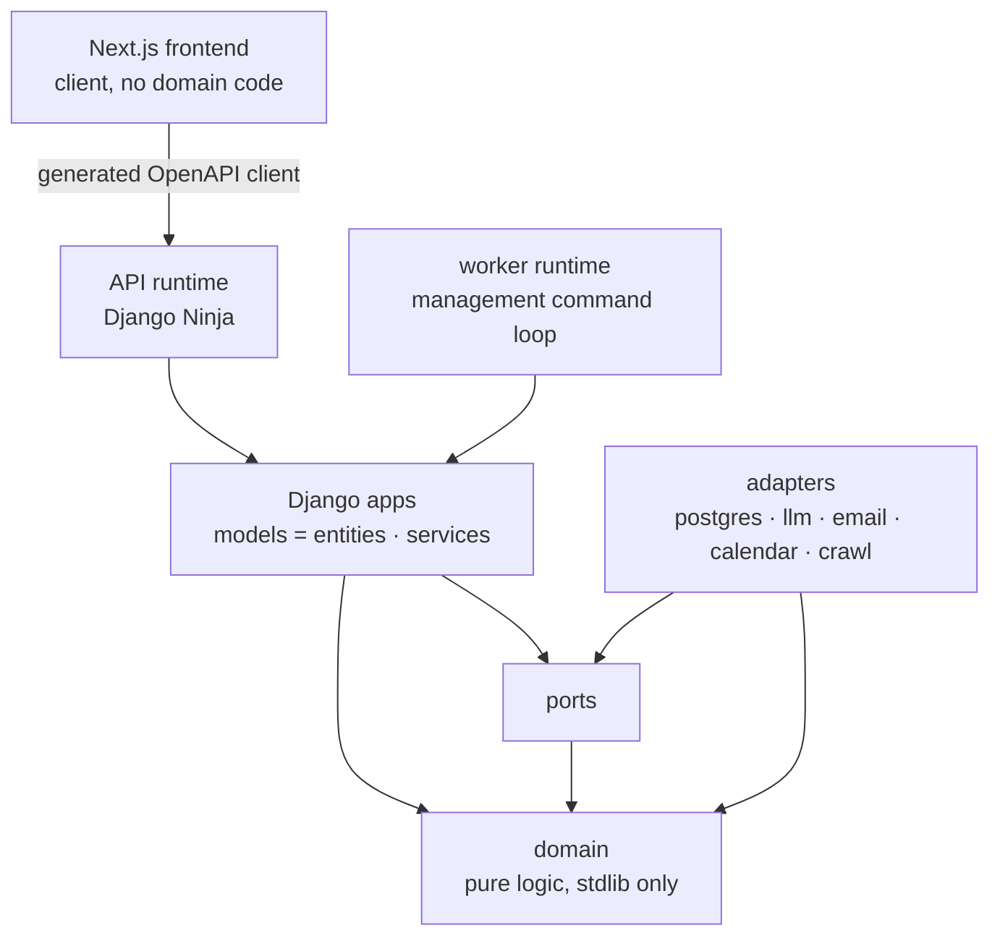
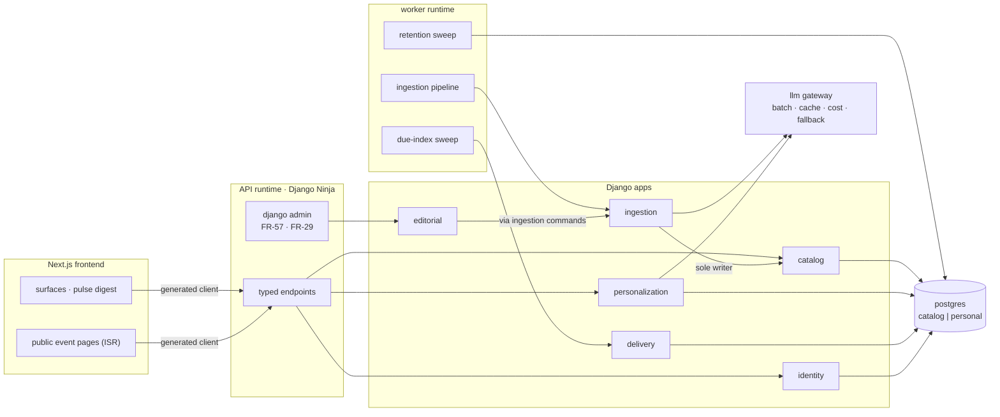
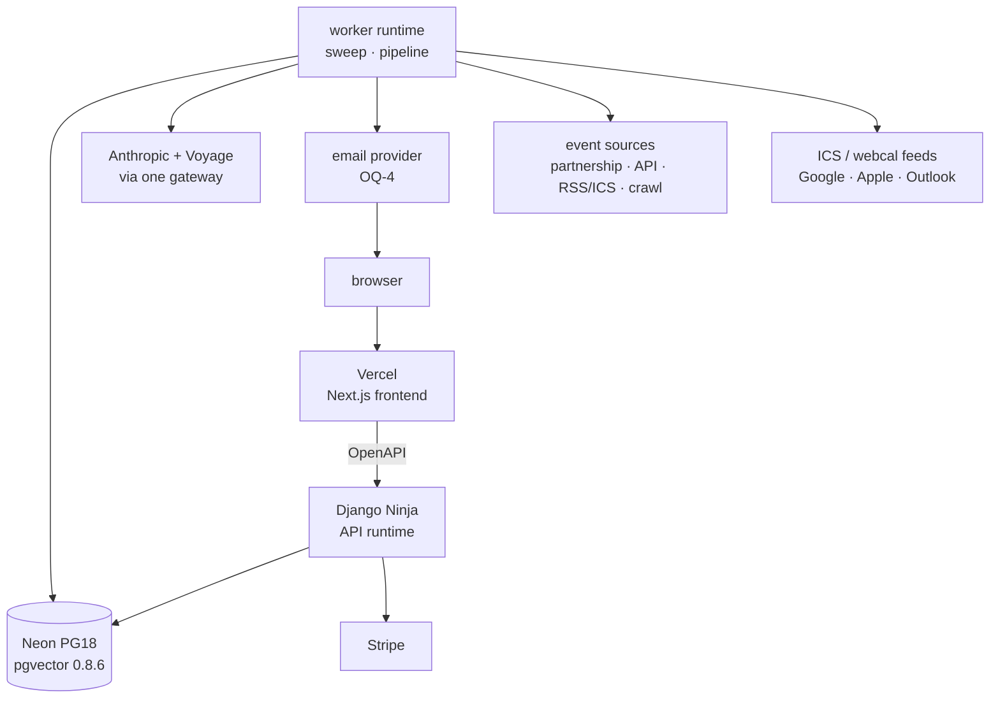
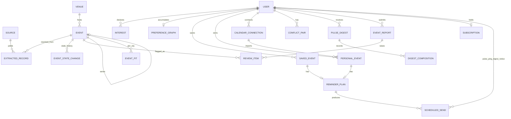

# Architecture Spine — EventPulse24

> **Terminology is not ours to choose.** PRD §3 Glossary binds every term used here; introducing a synonym is a discipline violation. Where this spine needs a noun the Glossary lacks, it is marked **[NEW NOUN]** and must land in the Glossary in the same pass.

## Design Paradigm

**Django modular monolith with ports-and-adapters at every external edge, running as two Python runtimes from one repository, served to a separate Next.js client.**

One backend codebase, one database, one set of Python domain packages. Two backend deploys — an **API runtime** (Django Ninja) and a **worker runtime** (long-lived loop) — plus the **Next.js frontend**, which is a *client* of the API and shares no domain code with it.

| Layer | Location | May import |
| --- | --- | --- |
| Domain — pure logic + value objects, **no Django, no I/O, no entity classes** | `backend/domain/` | stdlib only |
| Django apps — **models (the entities)**, services, API routers | `backend/apps/<module>/` | domain, ports |
| Ports — interfaces the apps require | `backend/ports/` | domain |
| Adapters — DB, LLM, email, calendar, crawl | `backend/adapters/<tech>/` | ports, domain |
| Surfaces — API routers, worker commands | `backend/apps/*/api.py`, `backend/worker/` | apps, ports |
| Client — Next.js | `frontend/` | the generated OpenAPI client only |

The six MVP modules, each a Django app: `ingestion`, `catalog`, `personalization`, `delivery`, `identity`, `editorial`.



## Invariants & Rules

### AD-1 — Workload separates runtimes, not features `[ADOPTED]`

- **Binds:** all
- **Prevents:** a crawl or LLM batch competing with Pulse Digest composition for the same process, blowing the <500ms p95 budget — which PRD §10.5 classifies as a SEV-1 incident.
- **Rule:** Three deploys. The **API runtime** and the **worker runtime** are both Python, deploy separately from the same repository, and share `domain`, `apps`, `ports`, `adapters`; neither imports the other's surface layer. The **Next.js frontend** is a client — it holds no domain logic and reaches the backend only through the generated API client (AD-19). A module is never duplicated across runtimes.

### AD-2 — Dependencies point inward, and `domain` is logic, not entities `[ADOPTED]`

- **Binds:** all
- **Prevents:** the modular monolith degrading into a big ball of mud, where the wall is a convention that compiles fine when violated — *and* the opposite failure, a parallel entity model that drifts from the Django model it mirrors.
- **Rule:** **Django models are the entities.** There is exactly one representation of an entity, and it is the model — the admin operates on it directly. `domain/` holds **pure logic only**: functions and value objects that take plain data and return plain data. It defines no entity classes, performs no I/O, and imports **stdlib only** — a domain module must be importable with Django uninstalled. Adapters never import other adapters. Cross-module calls go through the target app's published service interface, never its models or internals.
- **Enforcement:** `import-linter` contracts in CI, not review. Two contracts: `domain` may import stdlib only; `apps.<X>` may not import `apps.<Y>.models`.
- **What belongs in `domain`:** the algorithmic core that must be testable without a database — dedup identity derivation (AD-4), UTC conflict detection (AD-6), quiet-hours due-time shifting (AD-7), ranking. Pydantic extraction schemas are an *adapter* concern and live with the LLM adapter, not here.

### AD-3 — Public and personal data are schema-separated `[ADOPTED]`

- **Binds:** FR-3, FR-18–20, FR-50, FR-52; PRD §10.2
- **Prevents:** a convenience join that makes the isolation requirement, the 30-day deletion guarantee, and the per-category retention windows unenforceable.
- **Rule:** Public event data lives in schema `catalog`; personal user data in schema `personal`. **No foreign keys and no SQL joins cross that boundary.** Composition happens in the application layer. Account deletion is a `personal`-scoped operation that never touches `catalog`.
- **Enforcement:** the two schemas are exposed as **two Django `DATABASES` entries** against the same Postgres with different `search_path`, behind a database router. Django cannot create relations or joins across databases, so the ORM itself refuses a cross-schema join — the framework is the enforcement mechanism, and the mistake is impossible to *write*, not merely wrong at runtime. Connection roles additionally `GRANT` on their own schema only.
- **Accepted cost:** **no transaction spans both schemas.** `transaction.atomic(using=...)` is per-schema. Any operation touching both must be ordered and idempotent rather than all-or-nothing — this is the direct consequence of AD-17's propagation rule, not a workaround for it.
- **Spike required:** confirm the `search_path`-per-connection pattern behaves correctly under Django 6.1 migrations (`allow_migrate` per database) before this is relied on.

### AD-4 — Event Identity is the sole dedup authority; embeddings never decide it `[ADOPTED]`

- **Binds:** FR-13–17, FR-53–55, FR-60
- **Prevents:** two owners of one entity, and the specific divergence of a builder reaching for cosine similarity as an identity test — which silently merges distinct events and is explicitly forbidden by PRD §3.
- **Rule:** The `ingestion` module is the **sole writer** of `catalog`. Identity is decided **only** by the Glossary's Event Identity tuple `(source_id, source_event_id, venue_fingerprint, start_time_with_tz, title_fingerprint)` and its three match rules. **Embedding cosine similarity is never an identity signal.** Cosine ≥0.95 routes a pair to the editorial review queue as "possible duplicate" and never auto-merges. Recurring events are distinct `event_id`s sharing a `series_id`.
- **Rule (state):** State changes — postpone, cancel, move, sold-out — update the same `event_id` and **append** to `state_history`; history is never rewritten. Propagation into `personal` is AD-17's, not this module's. A postponement within ±30 days of the original start keeps the `event_id`; beyond ±30 days it creates a new Event. The old Event then receives a terminal `superseded_by` state change pointing at the new one, which AD-17 propagates like a cancellation — users are notified and re-save; plans are never silently migrated.

### AD-5 — State changes only through named commands `[ADOPTED]`

- **Binds:** all
- **Prevents:** two builders inventing two mutation paths for the same entity, so invariants live in one path and not the other.
- **Rule:** No route handler, job, or adapter writes to the database directly. Every mutation is a named application command that owns its validation and its audit-log write. Reads may bypass commands; writes may not.

### AD-6 — UTC is the storage truth, timezone is explicit `[ADOPTED]`

- **Binds:** FR-58, FR-60; PRD §11.6
- **Prevents:** the timezone bug class — the same event conflicting for one user and not another because two modules chose different reference frames.
- **Rule:** All instants stored as `timestamptz` in UTC. Every Event additionally carries an explicit IANA `start_time_tz` and a `tz_inference_confidence`. Conflict detection operates **only** in UTC. Display-time conversion happens at the presentation edge, never in domain logic. An Event with `tz_inference_confidence` <0.7 is not eligible for any Pulse Digest until editorial review completes.

### AD-7 — Delivery is an idempotent due-index sweep, and Quiet Hours shift due time `[ADOPTED]`

- **Binds:** FR-9–12, FR-5–8, FR-51; PRD §10.4
- **Prevents:** the per-user-timer pattern — millions of individually scheduled future timers, where reschedule and cancel-on-event-change become O(timers) and a source postponement means hunting down every affected timer. With a broker in the stack this is a live temptation, not a theoretical one.
- **Rule:** Reminders and Pulse Pings dispatch from a worker sweeping a `(due_at, status)` index at **≤60s intervals**, triggered by Celery Beat. Every send carries a stable idempotency key (Rule (send key) below); delivery is at-least-once with dedupe at the send boundary. **The sweep must not be a platform cron** — Railway's cron floor is 5 minutes, which consumes the entire ±5 min budget before any queue latency, and skips a tick if the prior run is still active.
- **Rule (quiet hours):** Quiet Hours are applied when `due_at` is **computed or recomputed**, deferring to the window end — never as a skip at send time. A deferred send is silently moved, never dropped and never re-delivered next day.
- **Rule (send key):** The key is minted **once**, when the `SCHEDULED_SEND` row is created, stored under a unique constraint, and never derived from `due_at`:

| Send kind | Key |
| --- | --- |
| Reminder for a saved public Event | `user_id · event_reminder · event_id · slot · event_version` |
| Reminder for a Personal Event | `user_id · personal_reminder · personal_event_id · slot · personal_event_revision` |
| State-change notice (FR-54) | `user_id · state_notice · state_change_id` |
| Pulse Ping | `user_id · pulse_ping · local_date` |
| Pulse Digest email | `user_id · digest · local_date` |

  `event_version` and `personal_event_revision` are the values **at minting**; propagation may re-stamp a row's working `event_version` column (AD-17) but never its key. `slot` is the Reminder Plan slot (`5d`, `2d`, `1d`, `1hr`, or the custom slot's id). Quiet Hours, timezone, digest-time and tier changes **rewrite `due_at` on `pending` rows only and never touch the key**, so a recompute can never produce a second send. A lifecycle change that moves the event (AD-17) bumps `event_version`, cancels the old `pending` rows and mints new ones — the old key stays spent, so a `1d` reminder already sent for the old date does not block the `1d` reminder for the new one. The key is passed to the email provider as its idempotency key; a `sent` row is never rekeyed.
- **Rule (single writer):** A send row transitions state under a row-level lock (`SELECT … FOR UPDATE SKIP LOCKED`), so adding worker replicas can never double-send.
- **Rule (broker):** **Celery + Redis** runs background work. The broker carries the periodic tick and the pipeline jobs — crawl, extract, embed, propagate — and **nothing else**.
- **Rule (the schedule is never in the broker):** A reminder is **never** enqueued as a per-reminder Celery task at its due time. `SCHEDULED_SEND` rows in Postgres are the sole source of truth for what is due. This is the invariant AD-7 exists for: per-reminder tasks make reschedule and cancel-on-postponement O(timers) again, and would put delivery at the mercy of Redis durability, which is not guaranteed by default. Because the schedule lives in Postgres, **a total Redis loss costs in-flight pipeline jobs, never a user's reminder** — the next tick re-finds the row, and AD-17's outbox re-enqueues any lost propagation.
- **Rule (scheduler):** Celery's own beat scheduler with a **static `beat_schedule` in code**. `django-celery-beat` is not adopted: its purpose is admin-editable schedules, this schedule is one fixed tick, and its 2.9.0 release declares Django support only through 6.0 — not the 6.1 this project runs.

### AD-8 — Every model call goes through one gateway, which owns fallback `[ADOPTED]`

- **Binds:** FR-13–16, FR-29, FR-30; PRD §10.3
- **Prevents:** the per-MAU cost ceiling becoming unenforceable because cost is measured in six places — and a second module quietly adopting a different provider or a non-batched path.
- **Rule:** No module imports a provider SDK. All extraction, embedding, and enrichment calls pass through `backend/adapters/llm/`, which owns provider selection, batching, prompt caching, schema enforcement, and a **per-call cost row written in the same transaction as the result**. Cost accounting is not optional and not sampled. Extraction schemas are Pydantic models; structured output is enforced by the provider's constrained decoding, so no validate-and-retry loop is written by hand.
- **Rule (fallback):** Fallback is **multi-model within one provider, not multi-vendor.** Primary `claude-haiku-4-5`, fallback `claude-sonnet-5` — same SDK, same prompt, same gateway. *(Order flipped and ratified 2026-09-06: the cheaper model owns the happy path, which roughly doubles event-volume headroom inside PRD §10.3's ceiling.)* On primary unavailability or schema-validation failure the gateway retries on the fallback model; after 2 consecutive failures it pauses the source and pages editorial. Callers never implement their own retry or fallback.
- **Accepted risks of the Haiku-primary order, named:** (1) Haiku's confidence calibration may shift the `extraction_confidence` distribution downward, so the 0.5 / 0.7 gates are **tuning anchors until re-baselined against a labeled sample on the primary model** — a pre-launch task, not a budget; (2) date arithmetic for the AD-4 identity tuple and the ±30-day postponement rule is a known Haiku weakness, so those failures route to editorial review rather than auto-merge; (3) FR-29 dashboard curves are Haiku-shaped, and the runbook says so.
- **Accepted risk, named:** a **provider-wide** outage delays ingestion; it degrades no user-facing surface. PRD §10.4's 4-hour ingestion SLA already absorbs this, which is why a second text-model vendor is not bought. *(Requires the FR-14 amendment — it is written as multi-provider.)*
- **Rule (embeddings are a second vendor, unavoidably):** Anthropic publishes no embedding model and directs to **Voyage AI**. Embeddings therefore come from `voyage-4-lite`, behind the same gateway, with the same per-call cost row. Vectors are stored **quantized** — Voyage's `output_dtype` supports `int8` and `binary` (4× and 32× smaller), and Matryoshka dimensions allow truncating to 512 or 256. The embedding vendor is a **cost and storage** dependency, never an availability one: under AD-4 embeddings only route review candidates, so an embedding outage cannot stop ingestion or publishing.
- **Rule (confidence gate):** `extraction_confidence` <0.5 auto-rejects; <0.7 routes to editorial and is never published to a Pulse Digest. The threshold lives in one shared module.

### AD-9 — Source content is untrusted input `[ADOPTED]`

- **Binds:** FR-13–17, FR-21–25; PRD §11.2
- **Prevents:** sandboxing being satisfied for the crawler but not for the LLM path, where prompt injection from a scraped page is the live risk.
- **Rule:** Ingested content is never executed, never rendered as raw HTML, and never interpolated into a prompt without explicit delimiting. Extraction output is schema-constrained at decode time. Every derived record carries its `source_id` and a confidence score. A source can never cause a write outside `catalog`.

### AD-10 — Explanations are persisted with the decision, and there are two kinds `[ADOPTED]`

- **Binds:** FR-21–25, FR-59
- **Prevents:** the explanation drifting from the decision it explains — the trust-collapse failure PRD Risk 11 calls company-ending — and three surfaces computing three different answers to "why this?".
- **Rule (two kinds, one discipline):** Explanations come in two kinds, and **both are persisted, neither is ever recomputed at render**:

| Kind | Computed | Persisted on | Serves | Owner |
| --- | --- | --- | --- | --- |
| **Event Fit** `[NEW NOUN]` — non-personalized score + generic tags | per `(event, city)`, on ingest/refresh | `catalog` rollup | SEO pages, Pulse Preview — **anonymous, no session, cacheable** | `ingestion` |
| **Relevance Pulse** `[NEW NOUN]` — per-user score + per-user Why-this Tags | at digest composition | `DIGEST_COMPOSITION` (`personal`) | card, Detail Screen, email | `personalization` |

- **Why both exist:** the SEO landing page and Pulse Preview must show tags and a 1–5 indicator to a visitor with **no account** (PRD §UJ, UX `EXPERIENCE.md` UJ-3) — there is no user for a personal explanation to be *about*. AD-12 forbids that surface depending on a session, so a personal explanation cannot serve it. Event Fit is the session-free kind that can.
- **Rule (never cross them):** an authenticated surface never falls back to Event Fit to fill a missing Relevance Pulse, and a public surface never reads `personal`. Two indicators that look identical must never be silently substituted for one another — that is the trust-collapse failure PRD Risk 11 calls company-ending.
- **Rule:** Source Badge inputs follow the same discipline. A Pulse Card is a **projection**, not an entity (PRD §3) — the persisted record is the composition, and the card is derived from it.
- **Rule (durability):** A `DIGEST_COMPOSITION` row is immutable and retained per AD-15. The Detail Screen (FR-24) is reachable for an Event that is not in today's digest; it reads the **most recent composition** for that `(user, event)` pair, and renders no explanation rather than recomputing one if none exists. An explanation is never generated at view time.

### AD-11 — No long work inside a request `[ADOPTED]`

- **Binds:** all
- **Prevents:** discovering Vercel's 800s Pro ceiling (300s on Hobby) in production, and protecting the read-path latency budget.
- **Rule:** No request handler performs crawl, extraction, embedding, or bulk send. Such work is enqueued and executed in the worker runtime. A request handler's job is to validate, enqueue, and return.

### AD-12 — The public surface never depends on a session `[ADOPTED]`

- **Binds:** FR-26–28; PRD §10.4 (99.9% SEO uptime)
- **Prevents:** the cold-start acquisition path — the mitigation for PRD Risk 4 — being coupled to auth availability, and personalization leaking into cacheable pages.
- **Rule:** Public event pages render fully without a session and are statically generated or ISR'd. Personalized content on a public page arrives only via a separate client-side request. Schema.org `Event` JSON-LD is emitted from the same data the page renders.

### AD-13 — No PII in logs, redacted at the logger `[ADOPTED]`

- **Binds:** all; PRD §11.2, §11.4
- **Prevents:** compliance depending on every future author remembering — the failure mode of a convention.
- **Rule:** Structured JSON logs only. Redaction is enforced by the logger adapter's allowlist, not by call-site discipline. Email addresses, OAuth tokens, and personal event content never reach a log sink. Trace context propagates across extraction, dedup, personalization, and delivery.

### AD-14 — Internal actors are authenticated actors, never a privileged surface `[ADOPTED]`

- **Binds:** FR-29, FR-57, FR-59; PRD §10.5
- **Prevents:** the editorial tool becoming a second writer to `catalog` and bypassing AD-4 — and an unauthorized-access hole in the one surface that can publish or reject events.
- **Rule:** Editorial reviewers, AI Cost Dashboard viewers, and on-call operators are first-class authenticated actors with explicit role grants, modelled as `django.contrib.auth` groups and permissions. Django admin is the MVP surface for FR-57 and FR-29. The `editorial` app reads `catalog` and writes **through `ingestion` services** like any other client; it gets no privileged write path, no shared credential, and no unauthenticated route. Every editorial action (approve, reject, edit, merge) is attributed to an actor and appended to `state_history`. Admin write access is granted per-model, never as blanket superuser for routine review.

### AD-15 — Retention is a property of the table, swept by a job `[ADOPTED]`

- **Binds:** PRD §10.2 (all seven retention categories), FR-52
- **Prevents:** the 12-month preference-signal purge and the 90-day email-event window being implemented only for the tables one builder remembered.
- **Rule:** Every model holding user-derived data declares its retention category in one registry (a class attribute checked by a Django system check); a scheduled worker job sweeps against that registry. A model without a declared category fails `manage.py check`, so it cannot ship. Deletion and export (FR-52) read the same registry, so a new model is covered by all three paths at once.

### AD-16 — Write ownership is total, not just for `catalog` `[ADOPTED]`

- **Binds:** all
- **Prevents:** AD-4's sole-writer discipline protecting only half the database. `REMINDER_PLAN` is the concrete case: `personalization` legitimately writes it for FR-20's default plan and `delivery` legitimately writes it for FR-9's per-event picker — both fully compliant with every other AD, each carrying different invariants, and the second one to ship silently breaks the first.
- **Rule:** Every entity in **either** schema has exactly one owning module, per the table below. Only the owner writes it; every other module reads through the owner's published interface. Adding an entity without an owner fails review.
- **Rule (the contested one, settled):** `delivery` owns `REMINDER_PLAN`. `personalization` calls `delivery`'s published service to attach the default plan when it creates a `PERSONAL_EVENT` (FR-20). Chosen because PRD **SM-5 targets >80%** of saved cards getting a customized plan — plan edits are the frequent path, personal-event creation the rare one — so the boundary crossing sits on the rare path, and "edit the plan, reschedule its sends" stays inside the module AD-17 already makes the sole rewriter of `SCHEDULED_SEND`.
- **Rule (the default is a constant, not state):** FR-9 and FR-20 both hardcode the default plan as **1d + 1hr**. It is one named constant in `shared/`, beside the confidence thresholds — never two literals that can drift apart.

| Owner | Owns (writes) |
| --- | --- |
| `ingestion` | `SOURCE`, `EXTRACTED_RECORD`, `EVENT`, `EVENT_STATE_CHANGE`, `VENUE`, `REVIEW_ITEM`, `EVENT_FIT` |
| `identity` | `USER`, `SUBSCRIPTION` |
| `personalization` | `INTEREST`, `PREFERENCE_GRAPH`, `PERSONAL_EVENT`, `SAVED_EVENT`, `CONFLICT_PAIR`, `CALENDAR_CONNECTION`, `PULSE_DIGEST`, `DIGEST_COMPOSITION`, `EVENT_REPORT` |
| `delivery` | `REMINDER_PLAN`, `SCHEDULED_SEND` |
| `editorial` | nothing — acts only through `ingestion` commands (AD-14) |

### AD-17 — Catalog state changes reach `personal` only by propagation `[ADOPTED]`

- **Binds:** FR-53–55, FR-9–12, FR-33
- **Prevents:** the race the AD-3 wall makes invisible — a postponement rewriting an event's start time while the sweep is mid-dispatch on a reminder for the old time, sending a user a reminder for an event that moved. Also prevents `ingestion` reaching across the wall to fix it directly.
- **Rule:** `ingestion` never writes to `personal`. A lifecycle change (postpone, cancel, move, sold-out, editorial time edit, supersede) appends an `EVENT_STATE_CHANGE` row carrying the Event's new, monotonically increasing `event_version`.
- **Rule (outbox, so propagation cannot be lost):** The `EVENT_STATE_CHANGE` row is written with `propagated_at = NULL` in the **same `catalog` transaction** as the change. The propagation job is enqueued from `transaction.on_commit`, and a periodic reconciler on the beat tick re-enqueues any row still unpropagated after 5 minutes. A Redis loss or a crash between commit and enqueue therefore **delays** propagation; it never loses it.
- **Rule (propagation is per-user, versioned, idempotent):** The job calls each owner's published service — **`delivery`** rewrites or cancels `SCHEDULED_SEND` rows, **`personalization`** updates the `SAVED_EVENT` snapshot and re-evaluates `CONFLICT_PAIR`s (AD-21). Each user is applied in one `personal` transaction, keyed `(state_change_id, user_id)`, and **only if** the change's `event_version` is greater than the version already stored on that user's `SAVED_EVENT` — so a retried, partial or out-of-order run can neither double-apply nor let an older postponement overwrite a newer cancellation. `propagated_at` is set through an `ingestion` command once every affected user is done.
- **Rule (what each change does):** time moved → bump the snapshot, cancel `pending` sends, mint new ones (AD-7 send key), queue an FR-54 notice. Cancelled, rejected, or superseded (AD-4 >±30 days) → cancel `pending` sends, close conflicts, queue a notice. Sold-out or venue detail → re-stamp the version, keep sends, queue a notice.
- **Rule (the sweep never crosses the wall in a transaction):** AD-3 forbids a transaction spanning `catalog` and `personal`, so the claim transaction is **`personal`-only**. Every event-bound `SCHEDULED_SEND` carries the `event_version` it was scheduled against. After claiming a row, the sweep reads the Event's current `event_version` through `ingestion`'s read interface — a separate, non-transactional read. If the catalog version is newer, the row goes to `held_for_propagation` and is not sent; propagation then releases, rewrites or cancels it.
- **Accepted cost:** a change that commits between that version read and the provider call can still send one reminder for the old time. The window is seconds wide, and the FR-54 notice from propagation corrects it. Closing it fully would need the cross-schema transaction AD-3 rules out.

### AD-18 — Calendar access is a port, and every credential is a credential `[ADOPTED]`

- **Binds:** FR-3, FR-50; PRD §11.2
- **Prevents:** the MVP's ICS import bleeding into `personalization` and `delivery`, so that adding OAuth later becomes a cross-module change — and prevents a secret ICS URL being treated as a config string when Google classifies it as a credential and offers a reset for it.
- **Rule:** All calendar ingestion sits behind one port. MVP ships a single **ICS/webcal adapter** used uniformly for Google, Apple and Outlook; OAuth and CalDAV adapters may be added behind the same port without touching any caller. Every provider credential — secret ICS URL or OAuth refresh token alike — is encrypted at rest with the application-level key, never logged, and revocable by the user.
- **Rule (identity is not calendar):** "Continue with Google / Apple / Microsoft" on `/signup` and `/signin` is **sign-in only**: OpenID Connect with `openid email profile` scopes, owned by `identity`. It never requests a calendar scope and never creates a calendar connection — calendar connect is the separate ICS step. Email + password, with single-use, short-lived reset tokens and enumeration-safe responses at the API edge, is the other MVP sign-in method. *(PRD FR-3/FR-50 aligned to this AD by PRD Amendment A-9.)*
- **Rule (connections are entities):** Each connected calendar is one `CALENDAR_CONNECTION` row (`personal`, owned by `personalization`) holding the encrypted credential. Every imported `PERSONAL_EVENT` references its connection, so a disconnect purges exactly that connection's events (FR-50: within 24 hours).
- **Rule (freshness):** The poll interval is ours to choose, since we are the HTTP client; imported events carry a `fetched_at` and conflict detection (FR-58) never asserts freshness it cannot evidence.

### AD-19 — The API contract is generated, never hand-written `[ADOPTED]`

- **Binds:** all frontend↔backend traffic
- **Prevents:** the divergence the separate-frontend decision created — two sides of one boundary drifting because each hand-maintains its own view of the payload. This invariant did not exist while the stack was one language with shared types.
- **Rule:** The OpenAPI schema Django Ninja emits is the **single source of truth** for the boundary. The frontend's TypeScript client is generated from it in CI and is never edited by hand; a schema change that breaks the client fails the build. Request and response shapes are Pydantic schemas in `apps/*/schemas.py` — never ad-hoc dicts. No endpoint exists that is absent from the schema.

### AD-20 — Transactional and bulk mail never share a stream `[ADOPTED]`

- **Binds:** FR-9–12, FR-5–8; PRD §10.1
- **Prevents:** `delivery` sends both reminders and the Pulse Digest through one adapter. Without a required stream argument, the second sender to ship silently inherits whatever default the first picked — and then one digest spam complaint degrades the deliverability of the reminders users explicitly asked for.
- **Rule:** Every send through the email port carries an explicit **stream**. Transactional mail (reminders, state-change notices, auth) and bulk mail (the Pulse Digest) use **separate sending streams and separate reputations**. A send with no stream is a type error, not a default.
- **Rule (RFC 8058):** Bulk sends carry `List-Unsubscribe` and `List-Unsubscribe-Post: List-Unsubscribe=One-Click`, with a POST endpoint that returns 200/202 and stops mail within 48 hours. Both candidate providers support this — Postmark attaches the headers automatically on its Broadcast stream, Resend takes them as custom headers — so it constrains the **port**, not the vendor.



### AD-21 — Timeline and conflicts read personal-side snapshots, never `catalog` joins `[ADOPTED]`

- **Binds:** FR-32, FR-33, FR-58, FR-53–55; PRD Amendment A-8
- **Prevents:** the Pulse Card, the Timeline and `/conflicts` each computing "does this overlap?" their own way across the AD-3 wall — so the PRD's symmetric conflict indicator disagrees between surfaces, and a cancelled event keeps its conflict marker.
- **Rule (saves are personal records):** A user's save of a public Event is a `SAVED_EVENT` row in `personal`, owned by `personalization`. It holds `event_id` by value (no FK) plus a snapshot — `start_utc`, `end_utc`, `event_version` — taken from `catalog` at save time and **thereafter updated only by AD-17 propagation**. A save re-reads the Event's version after commit and requests re-propagation for that user if it moved meanwhile, so a save racing a postponement cannot keep a stale snapshot. The Timeline and conflict detection read the snapshot; they never join `catalog`.
- **Rule (one overlap function):** Conflict detection is one pure function in `domain/conflict.py`: two UTC intervals conflict when they overlap by **strictly more than 15 minutes** (FR-33). It runs on save, on Personal Event create, edit or import, and on AD-17 propagation — **never at render**. Public-vs-public pairs are out of scope at MVP.
- **Rule (conflicts are persisted pairs):** Each detected conflict is one `CONFLICT_PAIR` row (`personal`, owned by `personalization`) linking two sides (each a `SAVED_EVENT` or a `PERSONAL_EVENT`), with status `active` or `resolved`. A user's choice is recorded on the pair as the Glossary's `ConflictResolution`. A resolved pair is immutable and never re-prompted. When propagation removes the overlap (a cancel, or a postpone past the partner), the pair closes as `cleared_by_state_change`, which is not a user resolution. The Pulse Card indicator, the Timeline event-block indicator and `/conflicts` all read the same rows, so the indicator is symmetric by construction.
- **Rule (Timeline is a query):** `/timeline` is a read-only `personalization` query over `SAVED_EVENT` and `PERSONAL_EVENT` for one week in the user's timezone. It performs no writes. Display fields for public Events (title, venue) are fetched from `catalog` through `ingestion`'s read interface and combined in the application layer (AD-3).

## Consistency Conventions

| Concern | Convention |
| --- | --- |
| Naming — entities | **PRD §3 Glossary terms verbatim**: `Event`, `Source`, `PulseDigest`, `ReminderPlan`, `PersonalEvent`, `PreferenceGraph`, `EventReport`, `ConflictResolution`, `SourceReliabilityScore`. A Pulse Card is a projection, never a table. |
| Naming — new nouns | `ExtractedRecord` **[NEW NOUN]** (a pre-canonical extraction awaiting Event Identity resolution), `ScheduledSend` **[NEW NOUN]** (one due reminder, Pulse Ping, digest or notice), `SavedEvent` **[NEW NOUN]** (a user's save of a public Event, with its propagated time snapshot), `ConflictPair` **[NEW NOUN]** (one persisted conflict between two of a user's events) and `CalendarConnection` **[NEW NOUN]** (one connected calendar and its encrypted credential) must be added to PRD §3 before build. |
| Naming — files | Backend `snake_case.py`, one concept per module; services as verbs (`compose_digest.py`), queries as `get_`/`list_`. Frontend `kebab-case.ts`. |
| Naming — UI components | Exactly the UX spine's names: `Card.PulseDigest`, `Input.ReminderSlot`, `Indicator.Confidence`, `Badge.Source`, `Sheet.ConflictResolution`, `Surface.{RouteName}`. |
| UI system | **None — binding** (EXPERIENCE.md §1, DESIGN.md Token Implementation Contract). No Material, no shadcn, no component kit. Vanilla components over the CSS-custom-property token layer; `<dialog>` for modals and sheets; hand-rolled tooltip per the DESIGN.md pattern. |
| Theming | Tokens are CSS custom properties; `data-theme="dark"` ships as the default attribute on `<html>`. **No `prefers-color-scheme` auto-switch at MVP** — the user picks explicitly. Dark is the source, light is a swap-out. |
| Motion | One 240ms opacity transition (`motion.fadeIn`), no transform. No animation library. Collapses to `transition: none` under `prefers-reduced-motion`. |
| Ids | UUIDv7 primary keys (time-sortable). Public event URLs use a separate slug, never the primary key. |
| Dates | `timestamptz` in UTC at rest; ISO-8601 with offset on the wire; IANA tz names, never fixed offsets. |
| Errors | Domain errors are explicit exception types defined in `domain/`, never bare `Exception`. HTTP mapping happens once, in a Django Ninja exception handler — never per-endpoint. |
| Error shape | `{ code, message, details? }` — `code` is a stable machine-readable slug; `message` follows the UX spine's voice: calm, no urgency language, no emoji. |
| Money | Integer minor units plus ISO-4217 currency. Never floats. |
| Confidence | **Four distinct scores, never conflated.** `extraction_confidence` (Event, `numeric(3,2)` in `[0,1]`, gates at 0.5 / 0.7); `tz_inference_confidence` (Event, same type, gates at 0.7); **Confidence Pulse** (per-user relevance, 1–5 presentation scale on a Pulse Card, from `DIGEST_COMPOSITION`); **Source Reliability Score** (Source, `[0,1]`, affects ranking only — never removal). Different owners, different tables, different thresholds. All thresholds live in one shared module. |
| State mutation | Named application commands only (AD-5). Audit-log write in the same transaction as the mutation. |
| Config | Validated once at startup into a typed settings object (pydantic-settings); no `os.environ` reads below `config/`. |
| Auth | Authentication resolved at the API edge; services receive an explicit actor argument, never a `request`. Internal roles are `django.contrib.auth` groups and permissions (AD-14). |
| Rate limiting | Per-IP and per-user at the surface edge (PRD §11.2). `EventReport` is capped at 5/user/day (FR-59); free-tier saves at 1 per 24h (FR-48). Limits are declared, not hand-rolled per route. |
| Feature flags | Server-evaluated, defaulting to off. Phase 2/3 features ship behind a flag or not at all. |
| i18n | All user-facing strings externalized from day one, English-only catalogue at MVP (PRD §11.6). |
| Migrations | Django migrations, forward-only, one per PR, reviewed for the AD-3 schema routing and the AD-15 retention declaration. |
| Tests | `domain/` unit-tested with no database and no Django. `import-linter` contracts enforce AD-2 in CI. `manage.py check` enforces AD-15. `axe-core` gates the frontend surfaces named in PRD §11.5 at zero serious/critical violations. |

## Stack

Verified current 2026-09-04. The code owns these once it exists.

**Backend — Python**

| Name | Version |
| --- | --- |
| Python | **3.13 pinned** — the only version Django 6.1 (≥3.12) and Celery 5.6.3 (≤3.13) both declare |
| Django | 6.1.1 |
| Django Ninja | 1.7.0 |
| Pydantic | 2.13.5 |
| PostgreSQL | 18 (Neon) |
| pgvector (server) | 0.8.6 |
| `pgvector` (Python) | 0.5.0 |
| Celery | 5.6.3 |
| Redis (broker) | managed instance, current at provision time |
| `anthropic` | 1.3.0 |
| `instructor` | 1.16.0 |
| Claude (extraction) | `claude-haiku-4-5` primary, `claude-sonnet-5` fallback (AD-8) |
| Voyage (embeddings) | `voyage-4-lite` — quantized, Matryoshka-truncated |
| `voyageai` | current at build time — verify before pinning |
| Stripe (Python SDK) | current at build time — verify before pinning |

**Frontend — TypeScript**

| Name | Version |
| --- | --- |
| Next.js | 16.3.4 (Active LTS) |
| React | 19.2.8 |
| Tailwind CSS | 4.x (PRD §16) |
| TypeScript | 5.x |
| Node.js | ≥20.9 |

**Not used, and why.** No ORM beyond Django's own — Django ORM plus `pgvector`'s Django integration covers the model layer, and vector similarity is raw SQL in any stack. No `django-celery-beat` — it exists for admin-editable schedules, this project has one fixed tick, and 2.9.0 declares Django support only to 6.0 (AD-7). No component library — DESIGN.md's "UI system: None" is binding. No starter template: every well-known free Next.js SaaS starter is ≥9 months stale and pinned to Next 15 or earlier, so adopting one costs a Next 15→16 migration before any feature work.

**Open pins.** Voyage pricing and the `voyageai` package version were not verified in this run, nor was the Stripe Python SDK version. Claude 4.7+ use a newer tokenizer producing ~30% more tokens for the same text, so PRD §10.3's per-MAU ceiling must be baselined against the model actually in use before it is treated as a budget.

## Structural Seed

### Deployment & environments

| Concern | Seed |
| --- | --- |
| Frontend | Vercel — Next.js 16 `cacheComponents` + `partialPrefetching` is what makes tens of thousands of ISR'd event pages viable. **Hobby while building; Pro is mandatory at launch** (see the launch gate below) |
| API runtime | An always-on Python host (~$5/mo, e.g. Railway Hobby). Free Python hosts sleep — Render's free web service idles out at 15 min with a ~1 min cold start, which an API cannot wear |
| Worker runtime | Celery worker + beat. Phase 0: run locally — the sweep needs no always-on host before there are users. Phase 1: a second always-on process, no execution limit |
| Broker | Managed Redis (~$5–10/mo). Carries the tick and pipeline jobs only — never the reminder schedule (AD-7), so losing it never loses a reminder |
| Database | Neon PG18 — ships pgvector 0.8.6, above the 0.8.4 line that fixed HNSW vacuum corruption; the managed alternatives checked (Supabase, RDS) lag at 0.8.2. Free tier carries Phase 0 |
| Cost path | Phase 0 (build): **~$10/mo** — Vercel Hobby and Neon Free are $0; the Python API needs an always-on host (~$5) and Celery needs Redis (~$5). Phase 1 (launch): Vercel Pro $20 + API/worker ~$5–20 + Redis ~$5–10 + Neon usage. Swappable by design — AD-1 and AD-11 keep the code ignorant of its host |
| Email | Resend or Postmark — **both verified to support RFC 8058**, so this is a preference, not a constraint. Two streams either way (AD-20) |
| Billing | Stripe Checkout + Customer Portal |
| Environments | `local` → `preview` (per-PR, Neon branch) → `production`. Preview never sends real email and never writes to the real Source Registry. |
| Secrets | Platform secret store only. Every calendar credential — the secret ICS/webcal address at MVP, OAuth refresh tokens and CalDAV passwords after the fast-follow — encrypted at rest with a separate application-level key (AD-18). |
| Observability | Structured JSON logs + distributed tracing across extraction → dedup → personalization → delivery. AI cost metrics on the same dashboard as latency (PRD §11.4). Anomaly detection on dedup merge rate. |
| Operations | Status page updated within 30 min of a SEV-1; `runbook.md` lives in the repo and is the on-call first stop (PRD §10.5). |
| Backups | Neon PITR; RPO <1h, RTO <4h (PRD §11.3). |

**Launch gate — hard.** The Vercel plan must be on **Pro before the Pro tier's Stripe checkout is enabled**. Hobby is non-commercial only, and Vercel defines commercial to include "any method of requesting or processing payment from visitors." Shipping paid billing on Hobby risks account suspension, which no code change mitigates. This belongs on the pre-launch checklist beside the DPIA (§10.1) and the accessibility audit (§11.5).

**Not a platform-cron fallback.** Vercel Hobby cron runs once per day at ±59 min precision, and even Pro cron is per-minute — AD-7's tick lives in Celery Beat for this reason, on every plan. Exactly **one** beat process runs; two would double-fire the tick, and only the `SKIP LOCKED` claim in AD-7 would stop the double send.



### Core entities



Schema `catalog`: `SOURCE`, `EXTRACTED_RECORD`, `EVENT`, `EVENT_STATE_CHANGE`, `VENUE`, `REVIEW_ITEM`, `EVENT_FIT`.
Schema `personal`: `USER`, `INTEREST`, `PREFERENCE_GRAPH`, `REMINDER_PLAN`, `PERSONAL_EVENT`, `SAVED_EVENT`, `CONFLICT_PAIR`, `CALENDAR_CONNECTION`, `PULSE_DIGEST`, `DIGEST_COMPOSITION`, `SCHEDULED_SEND`, `EVENT_REPORT`, `SUBSCRIPTION`.

Every `SAVED_EVENT → EVENT` and `SCHEDULED_SEND → EVENT` reference crosses the wall **by id only, with no FK** (AD-3); the time fields it needs are the snapshot that AD-17 propagation maintains.

`DIGEST_COMPOSITION` holds the persisted Why-this Tags, Confidence Pulse, and Source Badge for one Event in one user's digest at one composition time (AD-10). A **Pulse Card is a projection of it**, never a stored entity. `EVENT_REPORT` lives in `personal` because it is attributable to a user; the `REVIEW_ITEM` it raises lives in `catalog` and carries no user identity across the wall (AD-3).

### Source tree

```text
backend/
  config/          # settings, urls, asgi, database router
  domain/          # pure logic — stdlib only, no django, no entity classes
    dedup.py  conflict.py  quiet_hours.py  ranking.py  confidence.py
  apps/            # django apps: models · services · api · schemas · admin
    ingestion/  catalog/  personalization/  delivery/  identity/  editorial/
  ports/           # interfaces the apps require
  adapters/
    llm/  email/  calendar/  crawl/  billing/  logging/
  worker/          # management commands: sweep loop, pipeline, retention
  shared/          # errors, ids, time, confidence thresholds, retention registry
frontend/
  app/             # next.js app router — surfaces + public event pages
  components/      # vanilla components over the token layer (no UI kit)
  lib/api/         # GENERATED from OpenAPI — never hand-edited (AD-19)
  styles/          # design tokens as CSS custom properties
```

## Capability → Architecture Map

| Capability | Lives in | Governed by |
| --- | --- | --- |
| FR-1–4 Onboarding & account | `identity`, `personalization`, frontend, `adapters/calendar` | AD-5, AD-12, AD-15, AD-18 |
| FR-5–8 Pulse Digest | `personalization`, frontend | AD-3, AD-10, AD-11 |
| FR-9–12 Reminders & Pulse Ping | `delivery`, `worker` | AD-6, AD-7, AD-16, AD-17 |
| FR-13–17, FR-56, FR-60 Ingestion & sources | `ingestion`, `worker`, `adapters/crawl` | AD-4, AD-6, AD-8, AD-9 |
| FR-18–20, FR-58 Personal events & conflict | `personalization` | AD-3, AD-6, AD-16, AD-21 |
| FR-32 Unified Timeline (Week view, read-only) | `personalization`, frontend | AD-3, AD-6, AD-21 |
| FR-33 Conflict-aware scheduling, `/conflicts` | `personalization`, `delivery`, frontend | AD-6, AD-17, AD-21 |
| FR-21–25 Explainability & trust | `personalization` | AD-9, AD-10 |
| FR-26–28 Sharing & SEO | `catalog`, frontend | AD-12, AD-19 |
| FR-29 AI Cost Dashboard | `adapters/llm`, `editorial` (Django admin) | AD-8, AD-14 |
| FR-30 Caching & batching | `adapters/llm` | AD-8 |
| FR-48–52 Pro tier | `identity`, `adapters/billing`, `adapters/calendar` | AD-5, AD-15, AD-18 |
| FR-53–55 Event state sync | `ingestion`, `delivery`, `personalization` | AD-4, AD-7, AD-17, AD-21 |
| FR-57 Editorial review queue | `editorial` (Django admin) | AD-4, AD-8, AD-14 |
| FR-59 User event reports | `personalization`, `editorial` | AD-3, AD-14 |

## Deferred

| Deferred | Why it can wait | Revisit when |
| --- | --- | --- |
| Service extraction (separate deployables per module) | The seams aren't known yet; AD-1/AD-2 keep the boundaries real enough to split along later. | A single module's scaling or on-call profile diverges sharply from the rest. |
| Dedicated vector store | Further out than first estimated: the ~680 B/vector figure assumed 1536 float dimensions, but `voyage-4-lite` truncated to 512 dims with binary quantization is a small fraction of that. Dedup has no user-facing latency SLA, and under AD-4 embeddings only route review items. | Event corpus passes ~10M events, or re-embedding churn causes measurable index bloat. |
| Two-way calendar sync, RRULE expansion (FR-31) | MVP is read-only sync-in; two-way needs conflict-resolution semantics the PRD defers to Phase 2. | Phase 2 planning. |
| Group features / graph store (FR-34, FR-41) | Postgres tables carry MVP personalization; a graph store only pays off with group edges. | "Pulse the Group" enters a sprint. |
| Native mobile, push notifications | Web-first is a locked product decision; email + in-app is the MVP channel set. AD-7's sweep is channel-agnostic, so push is an adapter. | Phase 2. |
| Multi-region deployment | English-first, single-region MVP. String externalization is in place from day one, so the later move isn't a rewrite. | EU or APAC rollout is committed. |
| On-device inference (FR-39) | AD-8's gateway is the seam a local model slots into. | Blended AI cost approaches PRD §10.3's ceiling. |
| Worker replica pool sizing | AD-7's `FOR UPDATE SKIP LOCKED` rule makes replica count a capacity decision, not an architectural one. | Sweep latency approaches the ±5 min budget. |

## Open Questions

| # | Question | Why it blocks | Owner |
| --- | --- | --- | --- |
| ~~OQ-1~~ | **Resolved.** Calendar ships at MVP as read-only ICS import; the Google CASA assessment runs in parallel and no longer gates launch. | — | Closed |
| ~~OQ-2~~ | **Resolved.** ICS delivers real provider parity — Google, Apple and Outlook all expose ICS/webcal URLs. The asymmetry existed only because OAuth has no Apple equivalent. | — | Closed |
| OQ-7 | How aggressively does Google cache its own ICS endpoint? We control poll frequency as the HTTP client, but not Google's cache headers. | Unknown freshness of imported personal events weakens FR-58 conflict detection. Needs a live poll test before the interval is fixed. | Eng |
| ~~OQ-3~~ | **Resolved.** Not a contradiction — the Glossary was conflating two real things under one name. Both exist (AD-10): **Event Fit** is per-event and session-free; **Relevance Pulse** is per-user. The Glossary entry must be **split into two terms** so downstream work cannot conflate them again. | — | Closed → PRD amendment |
| ~~OQ-4~~ | **Resolved.** Both support RFC 8058 — Postmark attaches the headers automatically on its Broadcast stream, Resend accepts them as custom headers. Not a disqualifier for either; the requirement moved into AD-20 as a property of the port. | — | Closed |
| OQ-5 | Which 20 MVP sources, and what does each ToS review conclude? | AD-9 holds regardless, but the partnership/API/RSS/crawl mix determines how much of `adapters/crawl` is needed at all. | Product + Legal |
| OQ-6 | `ExtractedRecord`, `ScheduledSend`, `SavedEvent`, `ConflictPair`, `CalendarConnection`, **`EventFit`** and **`RelevancePulse`** are new nouns this spine needs. PRD §3 requires new nouns to land in the Glossary in the same pass. | Downstream epics and stories must not invent competing names. | Product |
